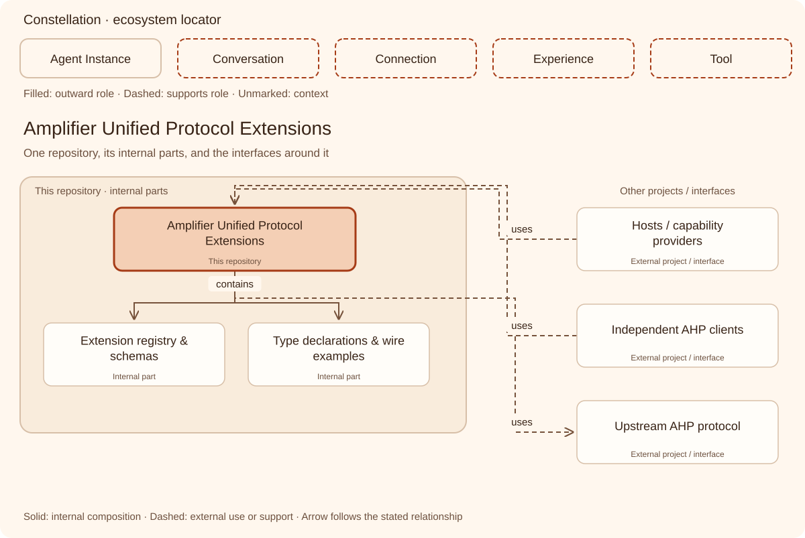

# Amplifier Unified Protocol Extensions

JSON Schemas, wire examples, and TypeScript declarations for optional Unified
capabilities carried over Agent Host Protocol (AHP). Use this package when building
a host, capability provider, or client that needs to agree on those message shapes.

It defines Unified-specific extensions, not the AHP or ACP protocols themselves.
No host, client, model, or native runtime is required to use the schemas.

## Get started

From a checkout:

```sh
npm ci
npm test
```

Start with [registry.json](registry.json), which lists the extension namespaces,
versions, and schemas. The [schema files](schemas/) are JSON Schema 2020-12;
[fixtures](fixtures/) show accepted wire objects, and [types](types/) provides
TypeScript declarations.

To add the package to another local project, install this checkout with
`npm install /absolute/path/to/amplifier-unified-protocol-extensions`. Consumers can
use its `registry.json` and `schemas/*` exports or import its declared types.

## Integration rules

Negotiate an optional capability before using it. A valid message shape is not
permission to perform an action: the provider must authenticate and authorize its
scope. Keep normal AHP operations for behavior they already describe, and keep
unknown outcomes visible rather than automatically resending actions.

Native Amplifier ACP extensions belong to
[amplifier-app-acp](https://github.com/microsoft/amplifier-app-acp).

## Reference and development

- [Extension contract](docs/extensions.v1.md)
- [Conformance checks](docs/conformance.md)
- [Registry](registry.json)

After schema changes, run `npm run generate`, `npm run check:generated`, and
`npm test`. `npm run verify:peers` separately checks the ordinary protocol examples
against upstream schemas.


<!-- ecosystem-map:start -->
## Where this fits

Shared definitions for optional AHP-carried capability messages used by hosts, providers and clients.

Supports: Experience, Conversation, Tool, Connection.



[Product page](https://microsoft.github.io/amplifier-constellation/projects/amplifier-unified-protocol-extensions/) · [Open the map](docs/ecosystem-map.svg) · [Map guide](https://github.com/microsoft/amplifier-constellation/blob/main/docs/ecosystem-maps.md)

<details>
<summary>The five shared building blocks</summary>

[](https://microsoft.github.io/amplifier-constellation/)

</details>

<!-- ecosystem-map:end -->

## Contributing

Most contributions require you to agree to a
Contributor License Agreement (CLA) declaring that you have the right to, and actually do, grant us
the rights to use your contribution. For details, visit [Contributor License Agreements](https://cla.opensource.microsoft.com).

When you submit a pull request, a CLA bot will automatically determine whether you need to provide
a CLA and decorate the PR appropriately (e.g., status check, comment). Simply follow the instructions
provided by the bot. You will only need to do this once across all repos using our CLA.

This project has adopted the [Microsoft Open Source Code of Conduct](https://opensource.microsoft.com/codeofconduct/).
For more information see the [Code of Conduct FAQ](https://opensource.microsoft.com/codeofconduct/faq/) or
contact [opencode@microsoft.com](mailto:opencode@microsoft.com) with any additional questions or comments.

## Trademarks

This project may contain trademarks or logos for projects, products, or services. Authorized use of Microsoft
trademarks or logos is subject to and must follow
[Microsoft's Trademark & Brand Guidelines](https://www.microsoft.com/legal/intellectualproperty/trademarks/usage/general).
Use of Microsoft trademarks or logos in modified versions of this project must not cause confusion or imply Microsoft sponsorship.
Any use of third-party trademarks or logos are subject to those third-party's policies.
